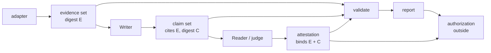

## Canonical evidence and claim model

This is the contract the change-evidence library (PER-171) implements: what an
adapter hands over, what an AI may assert about it, and what a validator must
refuse. A Clojure and a TypeScript implementation that follow it must produce
the same ids, the same digests and the same violation codes for the same input.

Design only. Read at `origin/main` `c037bc7`. Inputs: PER-172
(`current-system-map.md`, branch `PER-172-…` `a0cc241`), PER-173
(`public-tools.md`, `23931de`), PER-174 (`sem-adapter-spike.md`, `0f1885c`),
PER-186 (`current-review-packet-protocol-map.md`, `cd140de`).

Path shorthand: `ns/` = `skills/engineering-manager/scripts/review-packet/review_packet/`.

## Vocabulary

| Term | Meaning | Who produces it |
|---|---|---|
| **Evidence** | Facts derived mechanically from a change. Immutable once digested. | an adapter |
| **Claim** | A statement about evidence, citing it by id. | an AI or a person |
| **Characterization** | A claim set that covers its evidence set exactly. | the Writer |
| **Validation** | Mechanical check that claims are well formed, cite real evidence and cover it. Never judges truth. | this library |
| **Comprehension** | A reader's judgement that the claims explain the change. | the Reader |
| **Attestation** | A signed-off judgement bound to exact evidence and claim digests. | any judge; the library checks only the binding |
| **Authorization** | Permission to act (merge, push) granted on an attested set. | Ethan, Gatekeeper |

The library owns the first four rows' data and only validation's logic.

## Three documents, one report



Each is a separate JSON document. Today the claims are merged into the packet
(`ns/merge.clj:97`), which is why the validator needs `writable-only` and a
pre-merge `check-document` (`ns/validate.clj:503`). Separate documents make fact
immutability structural: a claim set has no fields that could overwrite a fact.
Merging stays a consumer's choice.

All documents share:

```json
{"schema": "change-evidence/<kind>", "version": 1, "digest": "sha256:…", "meta": {…}}
```

`meta` holds anything that may differ between two honest runs (timestamps,
host, packet URL). It is never digested and never validated.

## Canonical JSON and digests

- Encoding: RFC 8785 (JCS). Keys sorted by UTF-16 code unit; no insignificant
  whitespace; strings not Unicode-normalised.
- Numbers: integers only, within ±2^53−1. A float anywhere is `schema`.
- Keywords do not exist on the wire. Clojure writes `"code"`, not `:code`;
  namespaced keys keep their slash (`"file/hunk-label"`), as `ns/model.clj:351`
  already does.
- `digest(doc) = "sha256:" + hex(sha256(JCS(doc − {digest, meta})))`, lowercase.

**Unverified:** whether cheshire's output matches JCS for control characters
and non-BMP strings. Current digests use cheshire (`ns/model.clj:365`). PER-178
must add vectors for these before either implementation is trusted.

## Evidence set

```json
{"schema": "change-evidence/evidence-set", "version": 1,
 "subject": {"repo": "github.com/ezmiller/botserver-nix", "base": "<40-hex>", "head": "<40-hex>"},
 "sources": [{"id": "git", "tool": "git", "version": "2.53.0",
              "argv": ["diff", "--find-renames", "--unified=3"],
              "classifier": {"id": "review-packet.model", "version": 2,
                             "classes": ["code", "formatting-only", "generated", "lockfile",
                                         "binary", "rename", "mode-change"]},
              "complete": true}],
 "units": [ … ],
 "exclusions": [ … ],
 "digest": "sha256:…", "meta": {"built-at": "2026-11-04T00:00:00Z"}}
```

`subject.repo` is a stable name, not a filesystem path. The current facts
digest includes `repo/path`, `packet/id`, `packet/url` and `created-at`
(`ns/model.clj:343`), so two honest builds of one range never share a digest.
Those move to `meta` or to the packet.

### Unit types

Every unit has `id`, `type`, `source` (a `sources[].id`), and optional `alias`.

| Type | Coverage unit? | Id | Fields |
|---|---|---|---|
| `hunk` | **yes** | `h:` + 8 hex | `file`, `kind`, `class`, `heading`, `old`, `new`, `patch`, `stats` + per-kind fields |
| `file` | no (covered through its hunks) | `f:` + path | `path`, `status`, `from?`, `similarity?`, `mode?`, `binary`, `hunks[]` |
| `entity-change` | no | `e:` + 8 hex | `file`, `entity {type, name}`, `change`, `hunks[]`, `complete` |
| `dependency` | no | `d:` + 8 hex | `from`, `to` (entity keys), `relation`, `complete` |
| `test-link` | no | `t:` + 8 hex | `test`, `targets[]` (unit ids), `complete` |
| `test-run` | no | `r:` + 8 hex | `command`, `revision`, `result`, `exit`, `log-digest` |

Only hunks are coverage units, fixed, not configurable: entities and hunks are
many-to-many (PER-174: H-022 spans three entities, `build-packet` spans two
hunks), so entities cannot partition a change. Enrichment units cite hunks;
nothing cites the other way.

**Hunk kinds.** Today a file with no `@@` gets one synthetic hunk whose
*classification* carries its kind (`ns/model.clj:241-254`). That overloads
`class`: an added empty file is classed `code` (fixture `synthetic`, H-001).
The model splits them:

| `kind` | Extra fields | Today |
|---|---|---|
| `text` | — | real `@@` hunk |
| `binary` | `blobs {old, new}` (full object ids) | synthetic, class `binary` |
| `rename` / `copy` | `from`, `similarity` | synthetic, class `rename` |
| `mode` | `mode {from, to}` | synthetic, class `mode-change` |
| `empty` | `status` (`added` / `deleted`) | synthetic, class `code` |

`old`/`new` are `{start, count}` for `text` and `null` otherwise. `patch` is
the exact text: header lines plus every hunk's patch reassemble `raw.diff`.

### Identifiers

**Hunk id (`text`)**, kept byte-compatible with model v2 so existing ids survive:

    preimage = join("\n", [path, heading] ++ normalised-changed-lines)
    id       = "h:" + hex(sha256(utf8(preimage)))[0:8]

Normalisation is `ns/model.clj:68` and `:76`: drop trailing CR, collapse runs
of space/tab to one space, trim, drop lines blank after that, keep the leading
`+`/`-`; heading is the text after the closing `@@`, whitespace-collapsed;
context lines are not hashed. Collisions within one set take `-2`, `-3` in
adapter order (`ns/model.clj:89`).

**Hunk id (other kinds)**: same function, heading = the kind word, lines =

| kind | lines | change from v2 |
|---|---|---|
| `binary` | `["b" + blobs.old + ">" + blobs.new]` | **changed**: v2 hashes only `"b" + mode` (`ns/model.clj:243`), so every edit to `logo.png` gets `h:993ed0f9` and a citation from one range resolves to a different change in another |
| `rename`/`copy` | `["<" + from]` | none (`:246`) |
| `mode` | `[from + ">" + to]` | none (`:248`) |
| `empty` | `[status]` | none (`:254`) |

`ns/gitdiff.clj` reads `--raw -z` without `--no-abbrev` (`:167`) and discards
both object ids (`:75`). The adapter must add `--no-abbrev` and keep them;
checked on `fixtures/synthetic`, where `--no-abbrev` gives `346d7bb429…`.

**Other ids**: `"<prefix>:" + hex(sha256(utf8(join("\n", parts))))[0:8]` with parts

| type | parts | why |
|---|---|---|
| `entity-change` | `path, entity.type, entity.name` | PER-174: sem's `@L…` ids move under line shifts; refuse them as identity. An entity with no stable name is not a unit; its hunks cover it |
| `dependency` | `from, to, relation` | |
| `test-link` | `test, sorted targets…` | |
| `test-run` | `command, revision` | |

Entity keys in `dependency.from/to` are `path::type::name`, sem's own form
minus any `@L` suffix.

**Aliases.** `alias` is a display handle (`H-001`), assigned by the adapter in
adapter order, unique within the set. Claims may cite an alias or an id. The
claim digest is taken after aliases are rewritten to ids, so the spelling of a
citation never changes the digest.

**Stability.** Ids are stable across rebuilds of one range, not across ranges
(PER-172: none of `ab3a477`'s 34 ids appear in the whole-ticket packet). That is
correct: the evidence differs. Cross-range continuity is a chain concern
(`ns/chain.clj`), outside the library.

### Exclusions

Totality has two halves:

1. **Adapter totality**: every change in the subject is a unit or an
   `exclusions[]` entry: `{"path": "…", "reason": "<adapter vocabulary>", "detail": "…"}`.
   The Git adapter emits none today; every file gets at least one hunk
   (`ns/model.clj:236-254`). Reserved reasons: `size-limit`, `submodule`,
   `filtered`. **Unverified:** how `gitdiff` treats submodules.
2. **Claim totality**: every hunk unit is covered by exactly one claim (below).

An adapter source with `complete: false` records an omission it knows about,
such as sem `impact` dropping orphans with exit 0 (PER-174). Coverage never
depends on an incomplete source, because only hunks are coverage units.

## Claim set

```json
{"schema": "change-evidence/claim-set", "version": 1,
 "evidence": "sha256:<digest of the evidence set>",
 "author": {"tool": "change-summary-writer", "model": "claude-opus-5-5[1m]", "run": "PER-184"},
 "claims": [ … ],
 "structure": {"sections": [{"id": "noticing-the-break", "claims": ["c1", "c2"]}]},
 "profile": {"name": "review-packet", "version": 4, "fields": { … }},
 "digest": "sha256:…", "meta": {}}
```

### Claim types

Every claim: `id` (slug, unique), `type`, `text`, `covers[]`, `cites[]`, `basis`,
`confidence`.

- `covers`: hunk ids this claim accounts for. Counts toward coverage.
- `cites`: any unit ids, for support or context. Does not count.
- `basis`: `cited` (supported by its citations), `inferred` (reasoning beyond
  them), `reported` (taken from an outside statement; `from` names it).
- `confidence`: `high` / `medium` / `low`.

| Type | covers | Rules | Today |
|---|---|---|---|
| `explain` | ≥ 1 | | section body evidence item |
| `group` | ≥ 2 | `reason` ∈ {`repeated-pattern`, `mechanical`}; `representative` ∈ covers; `similar` ∈ {`identical`, `conceptual`}; `differences` iff conceptual | `collapsed` |
| `exclude` | ≥ 1 | `reason` ∈ classifier `classes`, and every covered hunk has that class | `collapsed` with reason `lockfile`/`generated`/`formatting-only` |
| `role` | 0 | cites exactly one `file` | `files[].role` |
| `risk` | 0 | | `risks[]`, plain strings |
| `test` | 0 | `result` ∈ {`pass`, `fail`, `partial`, `not-run`}; basis `cited` ⇒ cites one `test-run` at `subject.head` whose result equals this one | `tests[]` |
| `gap` | 0 | | `gaps[]`, plain strings |

`exclude` is new in what it checks. Today a group with reason `lockfile` is not
checked against the hunks' classifications (`ns/validate.clj:797`), so a Writer
can hide code behind a mechanical label. Here the reason is checked against
evidence.

Risks, tests and gaps gain citations and a basis. Today they are uncited
strings (`fixtures/701751b/writer.json`), so a risk naming the wrong file
passes.

### Structure and profile

`structure.sections` orders claims into an argument. The core checks only that
section ids are unique, claim references resolve, and no claim sits in two
sections. Narrative fields (title, thesis, scope, transitions, overview) and
their rules live in `profile.fields`, opaque to the core and checked by the
named profile. They are still digested, so an attestation binds them.

## Validation

`validate(evidence, claims?, attestations?, profile?) → report`, a pure function.
`claims` absent means facts-only: coverage reports every hunk as owed, which
is today's brief to the Writer (PER-172 use case 1).

```json
{"schema": "change-evidence/report", "version": 1,
 "evidence": "sha256:…", "claims": "sha256:…", "ok": false,
 "violations": [{"code": "coverage-exact", "layer": "claims", "where": "h:92afb754", "message": "…"}],
 "warnings": [],
 "validator": {"impl": "clj", "version": 1, "registry": 1}}
```

**Agreement** between implementations means equal `ok` and an equal multiset
of `(code, where)` over violations and warnings. Messages are free text.
Violations sort by registry order, then `where` by code unit.

`ok` is true iff `violations` is empty. All violations accumulate; nothing
short-circuits except `schema` on a document too broken to read (then every
other layer for that document is skipped).

### Failure codes

Seeded from `ns/validate.clj:70` (which absorbs `ns/contract.clj:301`). Order is
the registry order.

| Code | Layer | Rule | Seed |
|---|---|---|---|
| `registry-drift` | impl | profile rules all implemented | `contract-drift` |
| `schema` | schema | document matches its JSON schema: kinds, required fields, vocabularies of the core | `kinds`, `required-fields`, `vocabularies` (core part), `packet-version` |
| `source-mismatch` | adapter | evidence still matches its source; emitted only by an adapter's `verify` hook | `diff-coverage` |
| `id-recomputes` | evidence | every unit id equals its preimage hash | new |
| `id-unique` | evidence | ids and aliases unique | new (implicit in `assign-ids`) |
| `class-known` | evidence | every hunk class is in its source's declared `classes` | `classification` |
| `file-units` | evidence | every file's hunks resolve; every hunk in exactly one file; every file has ≥ 1 hunk | `file-hunk-integrity` |
| `stats-agree` | evidence | each hunk's `stats` count its patch | `stats-agree` (set-level stats become a derived view) |
| `enrichment-refs` | evidence | entity/test-link/dependency references resolve | new |
| `evidence-digest` | evidence | `digest` recomputes | `facts-immutable` |
| `claims-bind` | claims | `claims.evidence` equals the evidence digest | `packet-id-matches` |
| `citation-resolves` | claims | every `covers`/`cites`/`representative` id or alias resolves; `covers` names only hunks | `hunks-exist` |
| `coverage-exact` | claims | every hunk is in exactly one claim's `covers` | `coverage` |
| `claim-ids` | claims | claim and section ids are slugs, unique; structure refs resolve; ≤ 1 section per claim | `section-ids` |
| `group-shape` | claims | representative ∈ covers; `differences` iff conceptual | `representative-is-a-member`, `differences-iff-conceptual` |
| `reason-class-agrees` | claims | an `exclude` reason equals every covered hunk's class | new |
| `role-target` | claims | a role cites exactly one file | part of `files-exact` |
| `test-agrees` | claims | a cited test-run is at `subject.head` and has the claimed result | new |
| `basis-cited` | claims | basis `cited` ⇒ ≥ 1 citation; `reported` ⇒ `from` | new; seeds `body-items`' "evidence carries its explanation" |
| `claims-digest` | claims | `digest` recomputes | new |
| `attestation-bound` | attestation | attestation's evidence and claims digests equal the current ones | `verdict` (binding part) |
| `profile:<rule>` | profile | profile rules | `writable-only`, `files-exact`, `core-section`, `body-items`, `evidence`, `transitions`, `overview`, `limits`, `chain-references`, `verdict` (content), `comprehension` |

Warnings: `cites-incomplete` (a `high`-confidence claim cites a unit whose
source or self has `complete: false`), plus profile warnings
(`no-tests-run` etc., `ns/validate.clj:1050`).

## Attestation

```json
{"schema": "change-evidence/attestation", "version": 1,
 "evidence": "sha256:…", "claims": "sha256:…",
 "attester": {"tool": "packet-reader", "model": "claude-opus-5-5[1m]", "run": "PER-185"},
 "kind": "comprehension",
 "payload": {"verdict": "pass", "findings": [ … ]},
 "digest": "sha256:…", "meta": {}}
```

The core checks `attestation-bound` and nothing in `payload`. A profile reads
the payload (today: verdict vocabulary, every core section restated,
`ns/validate.clj:969`).

## The four boundaries

| | Input | Question | Owner | In library? |
|---|---|---|---|---|
| Validation | E, C | Are the claims well formed, cited and complete? | validator | **yes** |
| Comprehension | E, C | Do the claims explain the change? | Reader | no; payload only |
| Attestation | digests E, C + judgement | Which exact set was judged? | any judge | **binding check only** |
| Authorization | E, C, attestations | May this be pushed? | Ethan, Gatekeeper | no |

A valid characterization may be false. Validation proves only that nothing
was dropped and nothing cited is invented.

## The three boundary decisions

1. **`diff-violations` goes behind an adapter hook.** It re-parses `raw.diff`
   with `gitdiff` (`ns/validate.clj:338`), so it is Git-specific and needs the
   source, not the evidence. The core owns the code `source-mismatch` and the
   hook signature `verify(evidence, source) → violations`; the Git adapter
   implements it. The core's own integrity (`id-recomputes`, `evidence-digest`)
   needs no source.
2. **Digest and attestation binding belong in the protocol.** The Reader gate
   (`ns/validate.clj:955-1042`) and the approval preimage
   (`scripts/lib/kk-approval.sh:22`, facts digest + narrative digest) both bind
   the same two digests. Left to consumers, each recomputes them, and a
   TypeScript consumer would need the exact canonical encoding anyway. The
   verdict's *content* stays in consumers.
3. **Classification stays entirely in the adapter.** The core never classifies;
   it checks membership in the vocabulary the adapter declares
   (`sources[].classifier.classes`) and checks `exclude` reasons against it.
   A `docs` class, missing today (PER-172: `ab3a477` reads as 34 `code` hunks),
   is an adapter change that needs no core change.

## Worked documents

Evidence excerpts are real ids and values from the captured packets, recast
into this shape by hand. Claim sets are recast from real Writer output where
one exists. Digests shown as `sha256:…` are elided: no implementation exists
to compute them. Reports are the expected output under this design.

### 1. One file — `2c0f3e7`

Evidence (`PER-172 fixtures/2c0f3e7/packet.json`):

```json
{"subject": {"repo": "github.com/ezmiller/botserver-nix",
             "base": "5c41816df66092c69cebc8401a6fdd3d0c3f8a18", "head": "2c0f3e741bce2b060e266252e6ecdd0dce377af7"},
 "units": [
  {"id": "f:skills/engineering-manager/scripts/kk-packet.sh", "type": "file", "source": "git",
   "path": "skills/engineering-manager/scripts/kk-packet.sh", "status": "modified", "binary": false,
   "hunks": ["h:92afb754", "h:67c919ec"]},
  {"id": "h:92afb754", "alias": "H-001", "type": "hunk", "source": "git", "kind": "text", "class": "code",
   "file": "f:skills/engineering-manager/scripts/kk-packet.sh",
   "heading": "if [ \"$cmd\" = import ]; then",
   "old": {"start": 292, "count": 8}, "new": {"start": 292, "count": 9},
   "stats": {"added": 3, "removed": 2}, "patch": "@@ -292,8 +292,9 @@ …"},
  {"id": "h:67c919ec", "alias": "H-002", "…": "…"}]}
```

Facts-only report (no claims): two `coverage-exact` violations, `where`
`h:92afb754` and `h:67c919ec`. Today's run also lists
`[required-fields] files[].role` and `narrative.thesis`; those become
`profile:required-fields`.

Claims:

```json
{"claims": [
  {"id": "import-pins-the-pr", "type": "explain", "covers": ["H-001", "H-002"], "cites": [],
   "basis": "cited", "confidence": "high",
   "text": "The URL must match `github.com/PrimaryKids/<repo>/pull/<n>` before `gh` is called…"},
  {"id": "role-kk-packet", "type": "role", "covers": [], "cites": ["f:skills/engineering-manager/scripts/kk-packet.sh"],
   "basis": "cited", "confidence": "high", "text": "validates PR URLs on import"}]}
```

Report: `ok: true`. Tampers, from `PER-172 fixtures/tamper/`:

| Tamper | Today | Here |
|---|---|---|
| H-001 reclassified `formatting-only` | `stats-agree` + `facts-immutable` | `evidence-digest` (set-level stats are no longer stored, so no `stats-agree`) |
| cite `H-999` | `hunks-exist` | `citation-resolves` |
| cite `H-001` twice | `coverage` | `coverage-exact` |
| rename a file in the claims | `files-exact` | `citation-resolves` on the role |

### 2. Mechanical rename — `ab3a477`

`--prepare` renamed to `--keep-local` across 13 files, 34 hunks, all class
`code` (`PER-172 fixtures/ab3a477/packet.json`). Evidence is 13 `file` units and
34 `text` hunks, e.g. `h:88373dac` (H-003, `agents/personal/stack-manager.md`)
and `h:d38613a8` (H-005, `agents/stack-manager.md`).

The Writer's real group (`prod-p-20261029-96bc9a/writer.json`), recast:

```json
{"id": "stack-manager-copies", "type": "group", "reason": "repeated-pattern",
 "covers": ["H-003", "H-005"], "representative": "H-003", "similar": "conceptual",
 "differences": "The personal copy's line passes `--workspace personal --verify`; …", "basis": "cited", "confidence": "high",
 "text": "Each StackManager copy adds one `--keep-local` line to its list of kk-restack commands."}
```

What this fixture shows:

- A rename touching docs cannot be `exclude`d: every hunk is `code`, so
  `exclude` with any reason fails `reason-class-agrees`. The fix is an adapter
  `docs` class (decision 3), not a looser rule.
- The group is `conceptual`, so it must say what differs, and it does:
  "The personal copy's line passes `--workspace personal --verify`; the other
  passes neither…". Without it, `group-shape` fires.
- Its `since` paragraph is a profile field: chain continuity stays outside.

### 3. Clojure feature — `701751b`

10 files, 26 hunks, Bash/Clojure/ClojureScript (`PER-172 fixtures/701751b/`).
Git hunks, plus sem enrichment for `model.clj` (PER-174 hand mapping):

```json
{"sources": [{"id": "git", "…": "…", "complete": true},
             {"id": "sem", "tool": "sem", "version": "0.29.0", "binary/sha256": "30fa7ab7…22dc3",
              "argv": ["diff", "--commit", "701751b", "--format", "json"],
              "env": {"SEM_NO_NETWORK": "1", "SEM_NO_UPDATE_CHECK": "1", "SEM_NO_TELEMETRY": "1"},
              "complete": false}],
 "units": [
  {"id": "h:9fd36116", "alias": "H-022", "type": "hunk", "kind": "text", "class": "code",
   "file": "f:…/review_packet/model.clj", "new": {"start": 408, "count": 25}, "…": "…"},
  {"id": "h:62962ed7", "alias": "H-023", "…": "…"},
  {"id": "e:…", "type": "entity-change", "source": "sem", "file": "f:…/review_packet/model.clj",
   "entity": {"type": "function", "name": "build-packet"}, "change": "modified",
   "hunks": ["h:9fd36116", "h:62962ed7"], "complete": false},
  {"id": "d:…", "type": "dependency", "source": "sem",
   "from": "…/model.clj::function::facts-digest", "to": "…/model.clj::var::fact-keys",
   "relation": "uses", "complete": true}]}
```

sem's source is `complete: false` because `impact --diff` dropped 7 of 27
orphans on this commit (PER-174).

Claims, recast from the Writer's `noticing-the-break` section and its tests
and risks (`fixtures/701751b/writer.json`):

```json
{"claims": [
  {"id": "build-records-the-break", "type": "explain", "covers": ["H-022", "H-023"],
   "cites": ["e:…build-packet"], "basis": "cited", "confidence": "high", "text": "…"},
  {"id": "digest-covers-break", "type": "explain", "covers": ["H-020", "H-021"],
   "cites": ["d:…"], "basis": "cited", "confidence": "high",
   "text": "`fact-keys` gains `chain-break`, so the facts digest now pins it."},
  {"id": "stale-lease", "type": "risk", "covers": [], "cites": ["H-007"], "basis": "inferred",
   "confidence": "medium",
   "text": "`remote/head` is origin as last fetched, so a stale fetch gives a stale lease that Gatekeeper refuses."},
  {"id": "suite-not-run", "type": "test", "covers": [], "cites": [], "result": "not-run",
   "basis": "reported", "from": "PER-128 Programmer hand-off", "confidence": "high",
   "command": "skills/engineering-manager/tests/run-tests.sh",
   "text": "At branch head 021a727: 1542 passed, 8 failed, the same 8 as main afb0c22."}],
 "structure": {"sections": [{"id": "noticing-the-break",
                             "claims": ["build-records-the-break", "digest-covers-break"]}]}}
```

Expected report: `ok: true` once all 26 hunks are covered (the real document
covers each once); warning `cites-incomplete` on `build-records-the-break`,
which is `high` confidence citing a unit from an incomplete source. That
warning is the point: the Writer leaned on sem's caller list, which sem itself
flags as incomplete (`callersComplete: false`).

Attestation, recast from `fixtures/701751b/verdict.json`:

```json
{"evidence": "sha256:…", "claims": "sha256:…", "kind": "comprehension",
 "attester": {"tool": "packet-reader", "model": "claude-opus-5-5[1m]", "run": "PER-185"},
 "payload": {"verdict": "pass", "findings": [{"criterion": "sections", "severity": "advisory",
             "section": "recording-the-break", "request": "H-005 … does not carry the break …"}]}}
```

Editing any claim, section or profile field after this changes the claims
digest and yields `attestation-bound`.

### 4. Synthetic: rename, binary, mode, empty file

Captured on this branch: `fixtures/synthetic/{build.sh,raw.diff,packet.json}`,
built with the existing tooling; `build.sh` reproduces the same four hunk ids.

| Alias | v2 id | path | v2 class | model `kind` / `class` |
|---|---|---|---|---|
| H-001 | `h:50a1e315` | `empty.txt` | `code` | `empty` / `code` |
| H-002 | `h:993ed0f9` | `logo.png` | `binary` | `binary` / `binary`; **new id**, includes blobs `346d7bb…`→`a7dc397…` |
| H-003 | `h:eb466354` | `renamed.txt` ← `old.txt` | `rename` | `rename` / `rename`, `similarity` 100 |
| H-004 | `h:b7a56849` | `tool.sh` | `mode-change` | `mode` / `mode-change`, `100644`→`100755` |

The blob ids shown are the abbreviated ones in `raw.diff`; the unit holds the
full 40-hex ids.

Claims:

```json
{"claims": [
  {"id": "mechanical", "type": "exclude", "reason": "mode-change", "covers": ["H-004"],
   "cites": [], "basis": "cited", "confidence": "high", "text": "tool.sh made executable."},
  {"id": "logo", "type": "exclude", "reason": "binary", "covers": ["H-002"],
   "cites": [], "basis": "cited", "confidence": "high", "text": ""},
  {"id": "rename", "type": "exclude", "reason": "rename", "covers": ["H-003"],
   "cites": [], "basis": "cited", "confidence": "high", "text": ""},
  {"id": "empty", "type": "explain", "covers": ["H-001"], "cites": [],
   "basis": "cited", "confidence": "high", "text": "Adds empty.txt as a placeholder."}]}
```

Expected report: `ok: true`. Variants:

- `exclude` H-001 with reason `binary`: `reason-class-agrees` (class is `code`).
- Omit the `logo` claim: `coverage-exact` at `h:…` for H-002. A binary edit
  cannot vanish, as today.
- Two builds where `logo.png` changes differently: different `h:` ids. Under
  v2 both are `h:993ed0f9`.

## Conformance requirements (handed to PER-178)

Two implementations agree if, on every vector, they produce byte-identical
canonical JSON and digests, identical ids, and equal `(code, where)` multisets.
Minimum vectors:

1. Hunk id: whitespace-only reflow (same id), add vs delete of one line
   (different ids), CRLF vs LF (same id), duplicate change in one file (`-2`).
2. One id per non-text kind, from `fixtures/synthetic`.
3. JCS: non-ASCII, non-BMP, control characters, key order with mixed case.
4. Every failure code fired alone, from the four worked documents and their
   tampers.
5. Alias and id citations of the same claim set give one claims digest.

## Changes from model v2, in one place

| Change | Why |
|---|---|
| Claims are a separate document | immutability by structure; `writable-only` leaves the core |
| Packet id, URL, times, repo path leave the digest | equal ranges give equal digests |
| `kind` split from `class` | empty files were `code` |
| Binary id includes blob ids | v2 ids ignore content |
| `covers` separated from `cites` | enrichment can be cited without counting as coverage |
| `exclude` checked against `class` | mechanical labels can no longer hide code |
| Risks, tests, gaps carry citations and basis | uncited strings pass today |
| Set-level stats dropped from evidence | derived; one less rule to keep in sync |

## Unverified, and what depends on it

Nothing in the ordering of PER-176 → PER-177 or PER-175 → PER-178 depends on
these; each is a detail inside one of those tickets.

- cheshire vs JCS on escapes (PER-178).
- `gitdiff` behaviour on submodules (PER-176).
