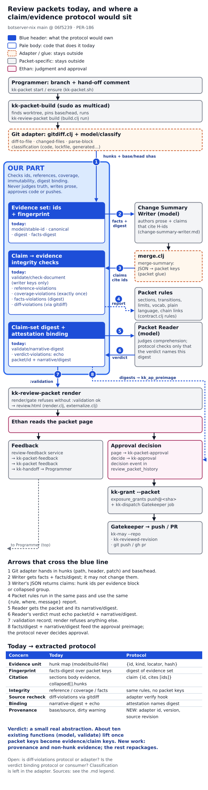

# Current review packets and the claim/evidence protocol

Read against `main` at `06f5239`. The PNG is a Chromium render of the SVG.
Paths below are under `skills/engineering-manager/` unless they start with
`agents/`.

## The boundary

The protocol owns four mechanical jobs: giving evidence stable ids, fingerprinting
the evidence set, checking that claims cite only known evidence and cover all of
it exactly once, and checking that a later attestation names the exact claim set
it judged. It never judges whether a claim is true, writes prose, approves code
or pushes.

## Where each box comes from

| Box | Source |
|---|---|
| Programmer → start/ensure | `scripts/kk-packet.sh` header (THE SEQUENCE), `start` / `ensure` |
| kk-packet-build | `scripts/kk-packet-build.sh` header; runs `kk-review-packet build` |
| build entry | `scripts/review-packet/build.clj` `run` (calls gitdiff, chain, `model/build-packet`) |
| Git adapter | `review_packet/gitdiff.clj` `diff-to-file` :34, `parse-block` :118, `changed-files` :159; `model.clj` `classify` :175, `build-file` :208 |
| Evidence set | `model.clj` `stable-id` :86, `canonical` :351, `digest` :365, `facts-digest` :375 |
| Writer | `agents/personal/change-summary-writer.md`; briefed by `kk-packet.sh` `send_brief` :809 via `dispatch` → `kk-handoff` :274 |
| merge glue | `merge.clj` `merge-summary` :97 |
| Claim → evidence checks | `validate.clj` `check-document` :503, `reference-violations` :580, `coverage-violations` :599, `facts-violations` :480, `diff-violations` :338 |
| Packet rules | `contract.clj` `rules`, `limits`, vocabularies; `validate.clj` `limit-violations` :859, `transition-violations` :670, `chain-violations` :923 |
| Binding | `validate.clj` `narrative-digest` :955, `verdict-violations` :969 (only its packet/id + digest echo check) |
| Reader | `agents/personal/packet-reader.md`; `send_read` :908 |
| validate calls | `kk-packet.sh` :1250 (`--stage narrative`), :1297 (`--comprehension`); stamp is `validate.clj` `record` :1161 |
| Render | `kk-packet.sh` :1327; `render.clj` `gate` :112; `externalize.clj` |
| Feedback | `scripts/kk-packet-feedback.sh` → `kk-packet feedback`; `scripts/review-feedback/` service |
| Approval | `scripts/kk-packet-approval.sh` `decide`; `scripts/lib/kk-approval.sh` `kk_ap_preimage` :22 (facts/digest + narrative/digest) |
| Grant | `scripts/kk-grant.sh` `--packet`; `scripts/lib/kk-dispatch.sh` Gatekeeper job |
| Gatekeeper | `agents/personal/gatekeeper.md`; `scripts/kk-may.sh`, `scripts/kk-reviewed-revision.sh` |
| Contract | `references/review-packet-contract.md` (pipeline, rules 1–14, the gate) |

## Uncertainties

- `diff-violations` re-parses `raw.diff` with gitdiff. It is drawn inside as a
  protocol check, but it may belong to the adapter as a "verify" hook.
- The binding check could stay with each consumer instead of the protocol. It is
  inside because the approval preimage reuses the same two digests.
- Classification (`model/classify`) is drawn in the adapter; it is evidence
  characterization, not a claim.
- Not read in depth: the review-feedback service internals and `kk-dispatch`
  job states. Their boxes rest on file headers only.
- "About ten functions" counts the functions cited in the blue boxes; it is not
  a measured extraction.
