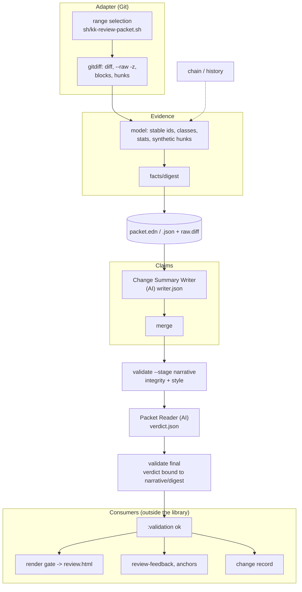

# Current change-evidence system map

What the review-packet pipeline does today, cut along the line a reusable
evidence/claim library would sit on. Read at `origin/main` `d041660`. Every row
cites the source; the examples are outputs the existing tooling produced.

Path shorthand:

- `ns/` = `skills/engineering-manager/scripts/review-packet/review_packet/`
- `rp/` = `skills/engineering-manager/scripts/review-packet/`
- `sh/` = `skills/engineering-manager/scripts/`

## Vocabulary used below

- **Evidence**: facts derived mechanically from Git: files, hunks, stats, ids.
- **Claim**: what the Change Summary Writer (an AI agent) asserts about the
  evidence: narrative sections that cite hunk ids, collapsed groups, file roles,
  risks, tests, gaps.
- **Integrity**: checks that the evidence still matches the diff and that every
  claim points at real evidence exactly once.
- **Comprehension**: the Packet Reader's (a second AI agent) verdict on whether
  the claims explain the change. The validator only checks that the verdict is
  well formed and bound to this exact narrative.

## Module map

| Module | Responsibility | Evidence | Reusable? |
|---|---|---|---|
| `sh/kk-packet-build.sh` | Privilege boundary: openclaw never runs git; this runs as multicad under sudo, checks the worktree, calls `kk-review-packet build`, prints the git facts as JSON | `sh/kk-packet-build.sh:19-34`, `:259-289` | No: host security plumbing |
| `sh/kk-review-packet.sh` | Resolves *which* commits: repo top level, parent branch, default branch, merge base, follow-up ancestry, remote head; then execs `build.clj` | `sh/kk-review-packet.sh:367`, `:377-401`, `:422`, `:446-458`, `:476-484`, `:487-500`, `:536` | Adapter-side (range selection), but in Bash |
| `rp/build.clj` | Entrypoint: arg checks, staging, empty-range exit 7, drives gitdiff → model → export | `rp/build.clj:121-180` (`run`), `:145-148` | No: CLI orchestration |
| `ns/gitdiff.clj` | Runs `git diff` and `git diff --raw -z`; parses records, file blocks, hunks, changed lines; pairs records with blocks positionally and refuses on count mismatch | `ns/gitdiff.clj:23-44`, `:64-90`, `:105-148`, `:159-173` | **Yes**: the Git adapter |
| `ns/model.clj` normalisation + ids | Normalised changed lines, stable hunk id `h:<sha256[0:8]>` over path, heading, normalised lines; collision suffix `-2` | `ns/model.clj:68-96` | **Yes**: evidence identity |
| `ns/model.clj` classification | `:code :formatting-only :generated :lockfile :binary :rename :mode-change`; lockfile list, generated-path regex, `@generated` marker | `ns/model.clj:108-183` | **Yes**: evidence attributes |
| `ns/model.clj` file/hunk build | Hunk entries with patch, stats, line ranges; synthetic hunks so binary, rename, mode-only and empty files remain accountable | `ns/model.clj:187-263` | **Yes** |
| `ns/model.clj` display ids | `H-001…` in Git order; per-file label `path H2` | `ns/model.clj:273-295` | **Yes** (claim citation handle) |
| `ns/model.clj` packet assembly | Packet id, URL, expiry, range, chain, stats, empty claim slots, warnings | `ns/model.clj:425-508` | Split: stats/evidence yes; id/URL/expiry no |
| `ns/model.clj` facts digest | Canonical JSON (sorted keys, keywords as strings) → `sha256:`; covers `fact-keys`, files minus `:role`, build warnings | `ns/model.clj:343-383` | **Yes**: evidence immutability |
| `ns/chain.clj` | Follow-up continuity: walks predecessor bundles, decides full vs incremental, 12 named fallback reasons, extends retention | `ns/chain.clj:10-26`, `:50-118`, `:120-129` | No: packet history |
| `ns/export.clj` | EDN/JSON serialisation; atomic publish with fixed modes; copies `raw.diff` byte-for-byte | `ns/export.clj:22-46`, `:93-143`, `:165-201` | Partly: JSON encoding yes; bundle layout no |
| `ns/contract.clj` vocabularies | Collapse reasons, similarity, test results, importance, verdicts, criteria, severities | `ns/contract.clj:50-97` | Claim types: yes. Values: packet-specific |
| `ns/contract.clj` prose limits + fields | Word/char/sentence limits; field kinds and requiredness | `ns/contract.clj:143-191`, `:201-294` | No: house style |
| `ns/contract.clj` rules | 18 named rules as data (coverage, hunks-exist, files-exact, writable-only, …) | `ns/contract.clj:301-345` | **Yes**: the rule register pattern |
| `ns/merge.clj` | Merges writer JSON into the packet; drops old verdicts on a new document; normalises the reader verdict | `ns/merge.clj:97-132` | **Yes**: claim intake |
| `ns/validate.clj` facts side | raw.diff vs packet patch text, classification set, file↔hunk ids, stats, facts digest | `ns/validate.clj:338-494` | **Yes**: integrity |
| `ns/validate.clj` document side | Pre-merge checks a merge would erase: packet id, writable-only keys, files exact | `ns/validate.clj:503-551` | **Yes** |
| `ns/validate.clj` references + coverage | Every cited id exists; every hunk appears exactly once across evidence and collapsed groups | `ns/validate.clj:580-618` | **Yes**: the central rule |
| `ns/validate.clj` sections, transitions, overview, collapsed, limits | Argument shape: core sections, transitions, overview links, prose limits | `ns/validate.clj:622-894` | No: narrative style |
| `ns/validate.clj` chain | `narrative.since` names the predecessor; no packet outside history | `ns/validate.clj:906-947` | No |
| `ns/validate.clj` comprehension | Narrative digest; verdict bound to packet id and digest; pass restates each core section | `ns/validate.clj:955-1042` | **Yes** as "attestation bound to a claim digest"; criteria no |
| `ns/validate.clj` `validate` | Accumulates all violations, sorted by rule order; stages `:narrative` / `:final` | `ns/validate.clj:1105-1143` | **Yes** |
| `rp/validate.clj` | CLI: read bundle, merge, record verdict only if usable, write `:validation`, exit 5 on fail | `rp/validate.clj:109-155` | No: CLI |
| `ns/render.clj` | HTML page; `gate` refuses render without a passing `:validation` for this packet and contract | `ns/render.clj:112-138`; second diff-line parser `:185-201` | No: consumer |
| `ns/anchor.cljc` | Feedback anchors; own diff-line parser with old/new line numbers; verifies anchors against a packet | `ns/anchor.cljc:21-68`, `:231` | Partly: line records are evidence; anchors are not |
| `ns/externalize.clj` | Size limits; replaces oversized hunks with cards carrying SHA-256 | `ns/externalize.clj:19-30`, `:65-90` | No: page budget |
| `ns/record.clj` | Colleague-facing change record: allowlisted projection plus banned-content scan | `ns/record.clj:23-39`, `:43-65` | No: consumer |
| `sh/kk-packet.sh` | Workflow: briefs writer, runs `validate --summary --stage narrative`, briefs reader, runs `validate --comprehension`, renders | `sh/kk-packet.sh:20-38`, `:1250`, `:1297`, `:1327` | No: Multica orchestration |

## The real Git boundary

`gitdiff` is the only module that *executes* `git diff` (plus `git status` for the
dirty-worktree warning, `ns/gitdiff.clj:46-50`), but it is not the only
code that runs git or parses diff text.

**Runs git, outside `gitdiff`:**

| Where | What | Evidence |
|---|---|---|
| `sh/kk-review-packet.sh` | `rev-parse`, `symbolic-ref`, `merge-base`, `merge-base --is-ancestor`, `cat-file -e`, `show-ref`: selects base and head, proves follow-up ancestry, reads remote head | `:367`, `:377-401`, `:422`, `:446-458`, `:479-481`, `:487-500` |
| `sh/kk-packet-build.sh` | Worktree ownership checks, then `git log base..head` for the commit list, `symbolic-ref`, `rev-parse HEAD` | `:184-192`, `:279-282` |

**Parses diff text, outside `gitdiff`:**

| Where | What | Evidence |
|---|---|---|
| `ns/model.clj` | Re-matches `gitdiff/hunk-header-re` for line ranges, headings, the `@generated` scan; strips `diff --git`/`index` lines for synthetic hunks | `ns/model.clj:76-79`, `:150-157`, `:199-203`, `:221-233` |
| `ns/validate.clj` | Re-splits raw.diff with `gitdiff/split-blocks` and `parse-block` and compares patch text | `ns/validate.clj:351-399` |
| `ns/anchor.cljc` | Independent parser: own `@@` regex, path from `+++ b/` or `diff --git a/… b/…`, per-line old/new numbers | `ns/anchor.cljc:30-68` |
| `ns/render.clj` | Independent line classifier for patch HTML | `ns/render.clj:185-201` |
| `review-feedback` service and UI | Reuse `anchor/diff-lines` / `line-records` on raw and delta diffs | `sh/review-feedback/review_feedback/packets.clj:29-30`, `sh/review-feedback/ui/review_feedback/ui.cljs:118` |

Consequence for the library: an adapter boundary at `gitdiff` alone would leave
range selection in Bash and three diff-line parsers downstream. A clean
adapter needs (1) range resolution as input, (2) hunk line ranges and
per-line records in the canonical evidence, so consumers stop re-parsing, and
(3) `anchor.cljc`'s path-from-`diff --git` parsing removed, since `gitdiff`
deliberately avoids it for quoted paths (`ns/gitdiff.clj:54-58`).

## Reusable core vs packet plumbing

**Reusable (evidence, claims, integrity):**

- Git adapter: `ns/gitdiff.clj:23-173`.
- Evidence identity and attributes: `ns/model.clj:68-263`, `:273-295`.
- Facts digest over canonical JSON: `ns/model.clj:343-383`.
- Claim intake that refuses writes to facts: `ns/merge.clj:97-118`,
  `ns/validate.clj:503-551`.
- Integrity rules: diff coverage, facts immutability, references, exact-once
  coverage: `ns/validate.clj:338-494`, `:580-618`.
- Rule register as data, all violations accumulated: `ns/contract.clj:301-345`,
  `ns/validate.clj:1105-1143`.
- Verdict bound to a narrative digest: `ns/validate.clj:955-1042`.

**Packet-specific (plumbing and style):**

- Packet id, URL, expiry, retention: `ns/model.clj:447-470`.
- Chain and history: `ns/chain.clj`, `ns/model.clj:399-423`.
- Narrative shape and prose limits: `ns/contract.clj:143-294`,
  `ns/validate.clj:622-894`.
- Bundle layout, publishing, rendering, records, size cards: `ns/export.clj`,
  `ns/render.clj`, `ns/record.clj`, `ns/externalize.clj`.
- Privilege boundary and workflow: `sh/kk-packet-build.sh`, `sh/kk-packet.sh`.

**Mixed, needs splitting:** `ns/model.clj` `build-packet` (`:425-508`) builds
evidence and packet metadata in one map; `ns/contract.clj` mixes reusable rule
ids with house-style limits; `ns/validate.clj` `validate` (`:1105-1143`) runs
both kinds in one pass.

## Data flow



## Use cases

Fixtures are single commits, built `<sha>^..<sha>` with the existing tooling.
Captured files live in `docs/change-evidence/fixtures/`.

Build command, run with `BUILD_DIR` set to `rp/` (what
`modules/kingkong-manager.nix` prepends to `sh/kk-review-packet.sh`):

    KK_REVIEW_PACKET_NOW=2026-11-01T00:00:00Z \
      kk-review-packet build --ticket <PER-172; PER-128 for 701751b> --repo <clone> \
        --base <sha>^ --head <sha> --no-merge-base --out <dir>
    kk-review-packet validate <dir> --stage narrative --dry-run

The Change Summary Writer and Packet Reader are Multica agents dispatched by
`kk-packet`. For `2c0f3e7` and `ab3a477` the writer documents come from the
production bundles in `/var/lib/review-packets` whose head is the fixture
commit, extracted from `packet.json` and re-validated. For `701751b` both
agents were run once, on Ethan's approval, against the fixture bundle itself
(use case 3). That run is the shared one for PER-173.

### 1. `2c0f3e7`: the smallest packet, and what integrity catches

One file, two hunks (`fixtures/2c0f3e7/packet.json`):

```json
"h:92afb754": {
  "classification": "code",
  "diff/header": "@@ -292,8 +292,9 @@ if [ \"$cmd\" = import ]; then",
  "display/id": "H-001",
  "file/hunk-label": "skills/engineering-manager/scripts/kk-packet.sh H1",
  "lines": { "new": {"count": 9, "start": 292}, "old": {"count": 8, "start": 292} },
  "stats": { "added": 3, "removed": 2 }
},
"facts/digest": "sha256:c96d22c396de3684b39db8e6ef69e0d07e38ab377e414632e224b92b0b273aa6"
```

Before any writer runs, the validator lists exactly what claims are owed
(`fixtures/2c0f3e7/validate-facts-only.txt`):

```text
[coverage] H-001: is not accounted for anywhere — skills/engineering-manager/scripts/kk-packet.sh H1 reaches the reader in neither the narrative's evidence nor a collapsed group
[required-fields] files[].role: is missing on files[0] skills/engineering-manager/scripts/kk-packet.sh
[required-fields] narrative.thesis: is missing
```

Editing one fact after the build (H-001 reclassified `:formatting-only`) is
caught twice (`fixtures/tamper/facts-tampered.txt`):

```text
[stats-agree] summary.stats.by-classification: records {:code 2} but the packet holds {:formatting-only 1, :code 1}
[facts-immutable] facts/digest: the facts no longer match the build's fingerprint (sha256:c96d22c3… was built, sha256:07bed31d… is here)
```

The production writer document for this head is PER-148's packet
`p-20261029-73e8ad` (range `4dbcd42..2c0f3e7`, 16 files, 45 hunks, so wider
than the fixture). A claim cites evidence by display id
(`fixtures/prod-p-20261029-73e8ad/writer.json`):

```json
{ "id": "import-pins-the-pr", "importance": "core",
  "body": [ { "evidence": ["H-023", "H-022", "H-003"],
              "explains": "The URL must match `github.com/PrimaryKids/<repo>/pull/<n>` before `gh` is called…" } ],
  "transition": { "to": "brief-or-mark-stale", "text": "A ticket checks out nothing by itself…" } }
```

Corrupting that document (cite `H-999`, cite `H-001` twice, rename a file)
yields (`fixtures/tamper/writer-tampered.txt`):

```text
[files-exact] not/a/file.sh: is not a file in the facts
[hunks-exist] narrative.sections[0] import-pins-the-pr body[1]: cites "H-999", which is not a hunk in this packet
[coverage] H-001: is accounted for 2 times; a hunk belongs to exactly one place
```

### 2. `ab3a477`: a rename across 13 files, and a follow-up packet

`fixtures/ab3a477/packet.json`: 13 files, 34 hunks, +90/−90, every hunk
`code`. Markdown docs classify as `code`; the vocabulary has no docs class
(`ns/model.clj:108-109`).

This commit is exactly the follow-up step of PER-144's incremental packet
`p-20261029-96bc9a`: its `action.diff` (`f59f853..ab3a477`) is byte-identical
to the fixture's `raw.diff` (checked with `cmp`). The packet records the chain:

```json
"chain": { "mode": "incremental", "predecessor": "p-20261028-fc577c", "reason": null },
"since-review": { "predecessor": "p-20261028-fc577c", "head": "f59f853…", "step?": true }
```

The writer's claims for the follow-up (`fixtures/prod-p-20261029-96bc9a/writer.json`):

```json
"since": "On p-20261028-fc577c Ethan flagged `--prepare` as too vague, asking what it prepares. This revision renames the flag to `--keep-local`…",
"collapsed": [ { "reason": "repeated-pattern", "hunks": ["H-003", "H-005"],
                 "similar": "conceptual", "representative": "H-003",
                 "note": "Each StackManager copy adds one `--keep-local` line to its list of kk-restack commands." } ]
```

Recorded verdicts (`fixtures/prod-p-20261029-96bc9a/validation-and-verdict.json`):

```json
"validation": { "ok": true, "contract/version": 4, "validator/version": 4, "violations": [] },
"comprehension": { "verdict": "pass", "findings": [ 2 advisory ] }
```

Stable ids do not carry across ranges: none of the fixture's 34 `h:` ids appear
in the production packet, because each hunk's changed lines differ between the
one-commit range and the whole-ticket range. They are stable across rebuilds of
the same range (`ns/model.clj:35-66`).

### 3. `701751b`: a full writer → reader → validator run

The one fixture whose claims were produced for this map, end to end. The bundle
was built under its real ticket, `--ticket PER-128`, so the brief and the facts
agree (`fixtures/701751b/facts-packet.json`, packet `p-20261101-88dfd0`): 10
files, 26 hunks, +164/−38, spanning Bash, Clojure and ClojureScript. Its
`raw.diff` is byte-identical to a `--ticket PER-172` build of the same commit.

**Owed claims.** Before the writer runs, the validator lists 45 violations: 26
uncovered hunks, 10 missing file roles, and the narrative fields
(`validate-facts-only.txt`).

**Writer.** It was briefed in `kk-packet`'s `send_brief` format
(`sh/kk-packet.sh:809-900`), with PER-128's real Programmer hand-off as the
only source of intent (`writer-brief.md`). It ran as PER-184 and returned
`writer.json`: four core sections and one supporting section, all 26 hunks
cited once, nothing collapsed.

```json
{ "id": "noticing-the-break", "importance": "core",
  "contribution": "Everything after depends on one fact the build now writes: that the reviewed history was rewritten, and which commit origin holds for the branch.",
  "body": [ { "evidence": ["H-007", "H-017", "H-018", "H-019"],
              "explains": "`kk-review-packet.sh` works out the branch name and, on a follow-up, passes `origin/<branch>` and the commit it pointed to when last fetched…" } ] }
```

The writer recorded every test as `not-run`, because the hand-off's results
are for the branch head, not this commit:

```json
{ "command": "skills/engineering-manager/tests/run-tests.sh", "result": "not-run",
  "note": "Not run at this commit; at branch head 021a727 it gave 1542 passed and 8 failed, the same 8 that fail on main at afb0c22." }
```

**Narrative-stage validation** (`validate-narrative.txt`) passed on the first
draft:

```text
p-20261101-88dfd0  PER-128  NARRATIVE VALID — 1 warning(s)
  warning: Every test in this packet is not-run. The reader has only the diff. (no-tests-run)
```

**Reader.** It was briefed in `send_read` format (`sh/kk-packet.sh:908-940`),
with the merged packet and nothing else (`reader-brief.md`). It ran as
PER-185 and returned `verdict.json`: `pass`, bound to
`narrative/digest sha256:5e83568b…`, with 3 advisory findings:

```json
{ "criterion": "sections", "severity": "advisory", "section": "recording-the-break",
  "request": "H-005 (the essay writer's brief) does not carry the break to the approval service. Either move it to showing-the-break, …" }
```

**Final validation** (`validate-final.txt`; recorded in `packet.json`):

```json
"validation": { "ok": true, "contract/version": 4, "model/version": 2, "validator/version": 4, "violations": [] }
```

**Model usage** (`usage.json`): both agents ran on `claude-opus-5-5[1m]`.

| Run | Wall time | Output tokens | Input (uncached) | Cache read | Cache write |
|---|---|---|---|---|---|
| Writer (PER-184) | 2m08s | 13,897 | 20 | 544,804 | 72,256 |
| Reader (PER-185) | 0m53s | 4,760 | 16 | 317,801 | 57,286 |

## Gaps and findings

- **Writer documents for `2c0f3e7`/`ab3a477` cover the ticket range**, not the
  single commit. For `ab3a477` the follow-up `since` and `action.diff` match
  the commit exactly; for `2c0f3e7` they do not.
- **Three diff parsers** (`gitdiff`, `anchor.cljc`, `render.clj`) and
  **range selection in Bash** make the adapter boundary wider than `gitdiff`.
- **Classification has no docs/config class**, so a docs-only rename reads as
  34 `code` hunks.
- Captured `packet.json` files record `repo/path` as the temporary clone used
  to build them. Before the `701751b` run, `fixtures/701751b/` held a
  `--ticket PER-172` build of the same diff. It was replaced by the PER-128
  build.
- **The `701751b` brief was assembled by hand** in `kk-packet`'s format, not by
  `kk-packet start`. The workflow needs a live ticket session, a worktree owned
  through `kk-packet-build`, and a watch. Briefs, facts, validator and agents
  are the real ones; the orchestration around them is not.
