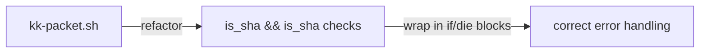

None

<!-- pr-agent-generated -->
### **PR Type**
Bug fix

___

### **Description**
- Refactor `is_sha` validation checks to use explicit `if` blocks

- Avoid relying on `||` short-circuit after compound `&&` conditions

- Applies to both PR import and start/ensure command paths

___

### Diagram Walkthrough

 
<h3> File Walkthrough</h3>

<table><thead><tr><th></th><th align="left">Relevant files</th></tr></thead><tbody><tr><td><strong>Bug fix</strong></td><td><table>
<tr>
  <td>
    

      
<strong>kk-packet.sh</strong><dd><code>Fix faulty `||` short-circuit logic for compound conditions</code></dd>

skills/engineering-manager/scripts/kk-packet.sh

<ul><li>Replaced <code>cmd1 && cmd2 || die ...</code> pattern with explicit <code>if ! { cmd1 && </code> <code>cmd2; }</code> blocks  <li> Fixes potential bug where <code>die</code> could trigger even if the compound  condition succeeded but had side effects  <li> Applied to PR import's base/head SHA validation  <li> Applied to start/ensure's review base/head pinned SHA validation</ul>

  </td>
  <td><a href="">+-1/--1</a>&nbsp; </td>

</tr>
</table></td></tr></tr></tbody></table>

___

