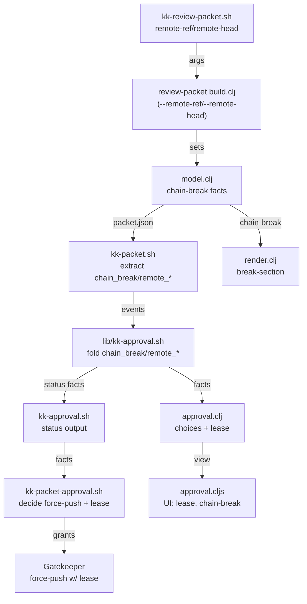

None

<!-- pr-agent-generated -->
### **PR Type**
Enhancement

___

### **Description**
- Add force-push approval path for review-chain breaks (PER-128)

- Track `chain_break`/`remote_ref`/`remote_head` through packet build and status

- Require a `--lease` matching recorded remote head for force-push

- Render chain-break UI section and force-push confirmation in packet/approval pages

___

### Diagram Walkthrough

 
<h3> File Walkthrough</h3>

<table><thead><tr><th></th><th align="left">Relevant files</th></tr></thead><tbody><tr><td><strong>Enhancement</strong></td><td>

10 files
<table>
<tr>
  <td><strong>kk-approval.sh</strong><dd><code>Include chain_break/remote fields in status facts</code>&nbsp; &nbsp; &nbsp; &nbsp; &nbsp; &nbsp; &nbsp; &nbsp; </dd></td>
  <td><a href="">+-1/--1</a>&nbsp; </td>

</tr>

<tr>
  <td><strong>kk-packet-approval.sh</strong><dd><code>Add force-push delivery choice gated by lease</code>&nbsp; &nbsp; &nbsp; &nbsp; &nbsp; &nbsp; &nbsp; &nbsp; &nbsp; &nbsp; &nbsp; &nbsp; </dd></td>
  <td><a href="">+-1/--1</a>&nbsp; </td>

</tr>

<tr>
  <td><strong>kk-packet.sh</strong><dd><code>Extract chain-break fields and craft break brief text</code>&nbsp; &nbsp; &nbsp; &nbsp; </dd></td>
  <td><a href="">+-1/--1</a>&nbsp; </td>

</tr>

<tr>
  <td><strong>kk-review-packet.sh</strong><dd><code>Pass remote ref/head for chain-break detection</code>&nbsp; &nbsp; &nbsp; &nbsp; &nbsp; &nbsp; &nbsp; &nbsp; &nbsp; &nbsp; &nbsp; </dd></td>
  <td><a href="">+-1/--1</a>&nbsp; </td>

</tr>

<tr>
  <td><strong>kk-approval.sh</strong><dd><code>Fold chain_break/remote_ref/remote_head into packet state</code></dd></td>
  <td><a href="">+-1/--1</a>&nbsp; </td>

</tr>

<tr>
  <td><strong>approval.clj</strong><dd><code>Add force-push choice, lease, and chain-break service logic</code></dd></td>
  <td><a href="">+-1/--1</a>&nbsp; </td>

</tr>

<tr>
  <td><strong>approval.cljs</strong><dd><code>Render chain-break facts and lease in UI</code>&nbsp; &nbsp; &nbsp; &nbsp; &nbsp; &nbsp; &nbsp; &nbsp; &nbsp; &nbsp; &nbsp; &nbsp; &nbsp; &nbsp; &nbsp; &nbsp; &nbsp; </dd></td>
  <td><a href="">+-1/--1</a>&nbsp; </td>

</tr>

<tr>
  <td><strong>build.clj</strong><dd><code>Add --remote-ref/--remote-head build flags</code>&nbsp; &nbsp; &nbsp; &nbsp; &nbsp; &nbsp; &nbsp; &nbsp; &nbsp; &nbsp; &nbsp; &nbsp; &nbsp; &nbsp; &nbsp; </dd></td>
  <td><a href="">+-1/--1</a>&nbsp; </td>

</tr>

<tr>
  <td><strong>model.clj</strong><dd><code>Compute chain-break data and include in packet schema</code>&nbsp; &nbsp; &nbsp; &nbsp; </dd></td>
  <td><a href="">+-1/--1</a>&nbsp; </td>

</tr>

<tr>
  <td><strong>render.clj</strong><dd><code>Add chain-break section and styling to packet page</code>&nbsp; &nbsp; &nbsp; &nbsp; &nbsp; &nbsp; &nbsp; </dd></td>
  <td><a href="">+-1/--1</a>&nbsp; </td>

</tr>
</table>
</td></tr></tr></tbody></table>

___

