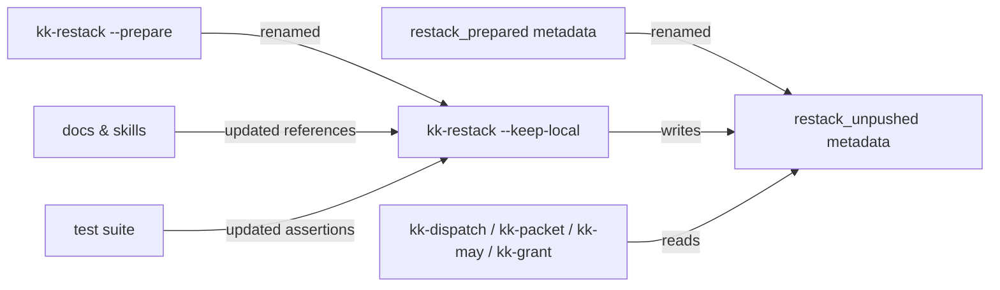

None

<!-- pr-agent-generated -->
### **PR Type**
Enhancement, Documentation, Tests

___

### **Description**
- Rename `--prepare` flag to `--keep-local` in `kk-restack`

- Rename `restack_prepared` metadata key to `restack_unpushed`

- Update all docs/skills referencing old flag and key names

- Update test suite messages and assertions to match renamed flag/key

___

### Diagram Walkthrough

 
<h3> File Walkthrough</h3>

<table><thead><tr><th></th><th align="left">Relevant files</th></tr></thead><tbody><tr><td><strong>Enhancement</strong></td><td>

3 files
<table>
<tr>
  <td><strong>kk-restack.sh</strong><dd><code>Rename --prepare flag to --keep-local and metadata key</code>&nbsp; &nbsp; &nbsp; </dd></td>
  <td><a href="">+-1/--1</a>&nbsp; </td>

</tr>

<tr>
  <td><strong>kk-dispatch.sh</strong><dd><code>Update settle_restack to use restack_unpushed key</code>&nbsp; &nbsp; &nbsp; &nbsp; &nbsp; &nbsp; &nbsp; &nbsp; </dd></td>
  <td><a href="">+-1/--1</a>&nbsp; </td>

</tr>

<tr>
  <td><strong>kk-packet.sh</strong><dd><code>Reference restack_unpushed instead of restack_prepared</code>&nbsp; &nbsp; &nbsp; </dd></td>
  <td><a href="">+-1/--1</a>&nbsp; </td>

</tr>
</table>
</td></tr><tr><td><strong>Documentation</strong></td><td>

9 files
<table>
<tr>
  <td><strong>kk-grant.sh</strong><dd><code>Update help text to mention --keep-local</code>&nbsp; &nbsp; &nbsp; &nbsp; &nbsp; &nbsp; &nbsp; &nbsp; &nbsp; &nbsp; &nbsp; &nbsp; &nbsp; &nbsp; &nbsp; &nbsp; &nbsp; </dd></td>
  <td><a href="">+-1/--1</a>&nbsp; </td>

</tr>

<tr>
  <td><strong>kk-may.sh</strong><dd><code>Update mismatch message to use --keep-local</code>&nbsp; &nbsp; &nbsp; &nbsp; &nbsp; &nbsp; &nbsp; &nbsp; &nbsp; &nbsp; &nbsp; &nbsp; &nbsp; &nbsp; </dd></td>
  <td><a href="">+-1/--1</a>&nbsp; </td>

</tr>

<tr>
  <td><strong>README.md</strong><dd><code>Document rename of flag and metadata key</code>&nbsp; &nbsp; &nbsp; &nbsp; &nbsp; &nbsp; &nbsp; &nbsp; &nbsp; &nbsp; &nbsp; &nbsp; &nbsp; &nbsp; &nbsp; &nbsp; &nbsp; </dd></td>
  <td><a href="">+-1/--1</a>&nbsp; </td>

</tr>

<tr>
  <td><strong>SKILL.md</strong><dd><code>Update kk-restack flag description</code>&nbsp; &nbsp; &nbsp; &nbsp; &nbsp; &nbsp; &nbsp; &nbsp; &nbsp; &nbsp; &nbsp; &nbsp; &nbsp; &nbsp; &nbsp; &nbsp; &nbsp; &nbsp; &nbsp; &nbsp; &nbsp; &nbsp; &nbsp; </dd></td>
  <td><a href="">+-1/--1</a>&nbsp; </td>

</tr>

<tr>
  <td><strong>stacking.md</strong><dd><code>Update stacking references to --keep-local</code>&nbsp; &nbsp; &nbsp; &nbsp; &nbsp; &nbsp; &nbsp; &nbsp; &nbsp; &nbsp; &nbsp; &nbsp; &nbsp; &nbsp; &nbsp; </dd></td>
  <td><a href="">+-1/--1</a>&nbsp; </td>

</tr>

<tr>
  <td><strong>stack-manager.md</strong><dd><code>Update restack flag and metadata references</code>&nbsp; &nbsp; &nbsp; &nbsp; &nbsp; &nbsp; &nbsp; &nbsp; &nbsp; &nbsp; &nbsp; &nbsp; &nbsp; &nbsp; </dd></td>
  <td><a href="">+-1/--1</a>&nbsp; </td>

</tr>

<tr>
  <td><strong>stack-manager.md</strong><dd><code>Update restack flag and metadata references</code>&nbsp; &nbsp; &nbsp; &nbsp; &nbsp; &nbsp; &nbsp; &nbsp; &nbsp; &nbsp; &nbsp; &nbsp; &nbsp; &nbsp; </dd></td>
  <td><a href="">+-1/--1</a>&nbsp; </td>

</tr>

<tr>
  <td><strong>gatekeeper.md</strong><dd><code>Rename restack_prepared mention to restack_unpushed</code>&nbsp; &nbsp; &nbsp; &nbsp; &nbsp; &nbsp; </dd></td>
  <td><a href="">+-1/--1</a>&nbsp; </td>

</tr>

<tr>
  <td><strong>gatekeeper.md</strong><dd><code>Rename restack_prepared mention to restack_unpushed</code>&nbsp; &nbsp; &nbsp; &nbsp; &nbsp; &nbsp; </dd></td>
  <td><a href="">+-1/--1</a>&nbsp; </td>

</tr>
</table>
</td></tr><tr><td><strong>Tests</strong></td><td>

1 files
<table>
<tr>
  <td><strong>run-tests.sh</strong><dd><code>Update tests for --keep-local and restack_unpushed</code>&nbsp; &nbsp; &nbsp; &nbsp; &nbsp; &nbsp; &nbsp; </dd></td>
  <td><a href="">+-1/--1</a>&nbsp; </td>

</tr>
</table>
</td></tr></tr></tbody></table>

___

